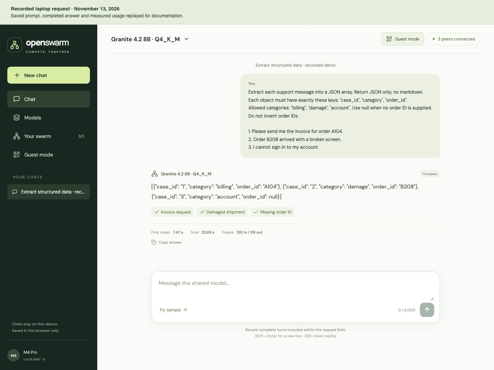
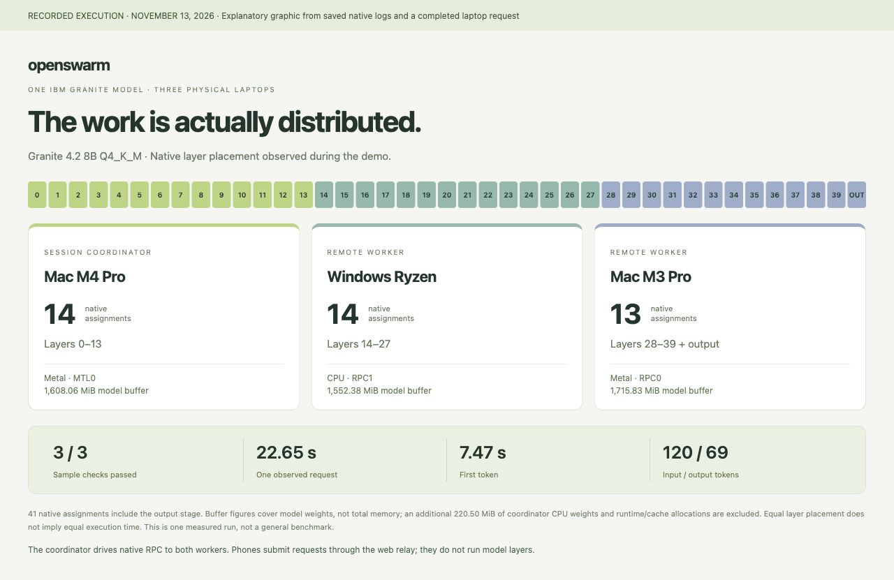
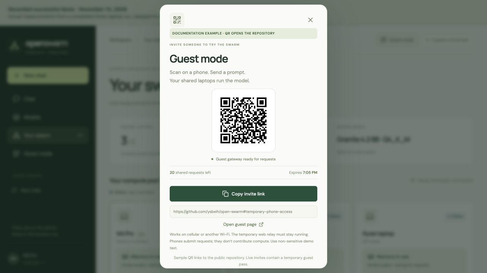

# Open Swarm

**Share compute. Use models. Together.**

You want to try an open AI model, but your laptop cannot spare enough memory to run it. The people around you have laptops too. What if you could pool that capacity?

Open Swarm is built around a simple idea: **share some of your computer's resources, and use the capacity others share with you.** Connect your laptops, pool the capacity you can spare, and use one AI model together. Each computer handles part of the work.

The goal is to help developers, students and small teams experiment with models beyond what one person can comfortably run alone, using hardware they already own. Shared AI capacity, built by the people using it—including here in Michigan.

## Share capacity, then put it to work

1. **Share your laptop.** Open the peer app and enable sharing. Every owner decides whether to contribute.
2. **Run one model together.** Choose the laptops taking part. They work together to run the same model.
3. **Use the shared model.** Send a prompt and get an answer powered by the group.

## See it in action

### 1. Share compute


See who is contributing and how much capacity they are offering. Each owner can enable or stop sharing. The 24 GB shown is the group's combined offer, not measured model memory use.

### 2. Use the shared model


Once the session is loaded, use the model from a participating laptop. The chat is the interface to the shared compute pool.

### 3. Get a completed answer



Put the model to work—for example, turning support messages into structured data. This replay shows a completed three-laptop request with all three sample checks passing.

### 4. See where the work ran



See how the model's work is divided across the laptops and what a request used. This graphic comes from the same recorded run as the response above.

<a id="temporary-phone-access"></a>

### 5. Optional extra: invite someone on a phone



Want someone else to try the shared model? Share a temporary QR or link. They can send a prompt from cellular or another Wi-Fi network while the laptops do the work. The phone does not need to join the hotspot and does not contribute compute.

*The QR in this documentation image opens the repository. Live guest passes are not published here.*

[Snapshot gallery and capture notes →](snapshots/README.md)

## What the prototype proves

The current prototype connects two or three trusted laptops on one local network. A broader cooperative network is the vision; internet compute membership and automatic discovery remain future work.

One **IBM Granite 4.2 8B Q4_K_M** model executed across a Mac M4 Pro, a Mac M3 Pro and a Windows Ryzen laptop at Michigan DevFest + AI Hackathon. The Macs used Metal; Windows used CPU. Native logs recorded 14 assignments on M4, 14 on Windows and 13 on M3, including the output stage. All three structured-data checks passed in the recorded request above: 120 input tokens, 69 output tokens and 22.651 seconds total. Equal layer placement does not imply equal execution time.

The 8B demo proves real distributed execution. It does not prove that 8B requires multiple machines. Testing a larger artifact that exceeds one owner's 8 GB contribution is the next step; **30B execution and memory fit remain unverified**. We have not demonstrated lower cost, higher speed or lower energy use than local or hosted alternatives. Request timings are individual observations, not general benchmarks.

**Built with:** IBM Granite · pinned native llama.cpp RPC · Python / FastAPI · React. Each session has a temporary coordinator, with no permanent central tracker. The native RPC data path runs through that coordinator. Process RSS is incomplete GPU/unified-memory accounting; graph submissions are not tokens or completed kernels.

## First setup on each Mac

Prerequisites: Git, Python 3.9 or newer (3.12 recommended), Node 22.12+ or 24, CMake 3.24+, Apple command-line developer tools. If Homebrew is already installed:

```bash
brew install cmake python@3.12 node@22
export PATH="$(brew --prefix node@22)/bin:$PATH"
git clone https://github.com/ysbeih/open-swarm.git
cd open-swarm
python3.12 -m venv .venv
.venv/bin/python -m pip install -r requirements.txt
npm --prefix frontend ci
npm --prefix frontend run build
.venv/bin/python scripts/build_runtime.py
```

The last command builds the pinned llama.cpp revision with Metal and RPC. Keep the checkout in the same folder after building. If the compiler is missing, run `xcode-select --install` and complete Apple's installer, then retry the build. If Homebrew is unavailable or starts a long source build on older macOS, resolve that prerequisite before continuing; do not upgrade the OS for the demo.

## Configure the two laptops

Both computers must be on a trusted LAN that permits peer connections. Find each Wi-Fi address with `ipconfig getifaddr en0` (use the active network interface if different). On **one** laptop, substitute the real addresses:

```bash
.venv/bin/python scripts/configure.py --a 192.168.1.10 --b 192.168.1.11
```

This generates `config/peer-a.json` and `config/peer-b.json` with a shared control token. Transfer B's file directly to B, for example with AirDrop. On each laptop copy its own file to `config/local.json`. Never commit or paste these files publicly. Do not generate independent tokens on the two laptops. The script refuses to overwrite existing configurations.

Start a temporary discovery worker on **B**:

```bash
.venv/bin/python scripts/devices.py --worker
```

While it is running, list the devices from **A**:

```bash
.venv/bin/python scripts/devices.py
```

Use the exact names shown by the pinned runtime. The M4 Pro is confirmed as `MTL0` from a normal Terminal. A typical two-Mac configuration on A is `"devices": ["MTL0", "RPC0"]` and `"tensor_split": [1, 1]`. Verify that MTL0 is the local Mac and RPC0 is B. Do not invent names if discovery fails. B can leave `devices` empty when contributing only; it needs discovery and the model file before it can coordinate a later session.

The first physical test used `"tensor_split": [9, 1]` over a private phone hotspot to reduce the initial transfer to B. Native logs reported 37 assignments on MTL0 and 4 on RPC0, including the output stage; this was an intentionally uneven split. An earlier equal-split load was stopped before generation because cold loading was slow. Copying the GGUF onto a worker does not bypass RPC tensor transfer.

New worker launches enable the native disk tensor cache (`--cache`), stored under ignored `.state/cache/rpc/`. The first load still transfers weights; subsequent loads can reuse cached tensors. The coordinator disables saved-prompt RAM caching (`--cache-ram 0`) after a physical run spent 51.7 seconds saving/restoring prompt state. This preserves the active attention KV cache. Restart the peer apps and shared session to apply these settings; existing native processes keep their original flags. In one physical two-Mac sequence, the initial cache-populating load took 241.8 seconds and the repeat load was observed ready at 39.7 seconds. A sample request after switching prompts took 9.0 seconds versus 63.8 seconds before the change. These are individual hotspot observations, not general benchmarks. Evidence and limits are recorded in `PROJECT_CONTEXT.md`.

Stop B's temporary discovery worker with **Ctrl+C** before starting the app-managed session. This releases its RPC port.

## Download the integration model on A only

```bash
.venv/bin/python scripts/download_model.py --size 8b
```

The downloader fetches the official IBM GGUF at an immutable revision, verifies its SHA-256 and writes metadata beside it. The 8B Q4_K_M download is approximately 5.35 GB. Only the coordinator needs the complete model file on disk; remote RPC workers receive their tensors from it. This is not per-peer torrent downloading.

### Larger-model experiment: 30B Q3_K_M

The official IBM Granite 4.2 30B Q3_K_M artifact is 14,133,162,720 bytes. Its weights exceed any one owner's 8 GB contribution, while a three-peer equal layer split is estimated at roughly 4.73 GB on M4, 4.66 GB on Windows and 4.57 GB on M3, plus coordinator embeddings, attention cache and runtime buffers. This is an estimate from the actual GGUF header, not a verified memory fit. A laptop with more available RAM could run it alone.

```bash
.venv/bin/python scripts/download_model.py --size 30b --quant Q3_K_M
```

Pinned candidate: `ibm-granite/granite-4.2-30b-GGUF`, revision `27b350a791e81d9a4d1ddca1c49282e9ec533768`, SHA-256 `7aad53fe80a9751d543ee6799d205a0a4f5d07e8d7f186b8753bdad7a12dc312`. Keep the verified 8B file for rollback. The downloader does not activate the new model. After full verification, stop the current session and back up the coordinator's ignored configuration before changing `model_path`, `model_name`, and `model_sha256` to the new artifact and restarting that peer app. Preserve the roster, shared token, measured device order, 8 GB offers and equal split. Workers do not need the model file; a worker with a configured model hash must accept the new artifact before a session can start. An empty worker hash permits the trusted coordinator's manifest, as on the existing M3 setup.

For a fresh setup only, `scripts/configure.py` also accepts `--model 30b --quant Q3_K_M`. Do not regenerate a working cluster's configuration or token. The dashboard distinguishes the configured model from a loaded session; a candidate card is not evidence of execution.

### Read-only demo check

```bash
.venv/bin/python scripts/check_demo.py
.venv/bin/python scripts/check_demo.py --json
```

Exit codes: 0 READY, 1 BUSY, 2 BLOCKED, 3 UNKNOWN. The checker validates every selected session member, matching session manifests, native runtime roles and observed layer placement. Before a session, it checks the saved roster. Worker-only laptops do not need coordinator weights or coordinator device settings. A failed direct refresh cannot reuse an earlier READY snapshot. This is a point-in-time readiness check; it neither starts inference nor proves a request will complete. A physical request and its recorded output remain the demo evidence.

### Choose two or three session participants

The saved roster can retain all three laptops. Before starting, choose participants under **Your swarm → Laptops for this session**. Select both Macs to run without Windows, or all three when Windows is available. Each selected owner must enable sharing. Participant selection does not rewrite `config/local.json`, rotate credentials or change the saved memory offers.

The authenticated `POST /api/session/start` also accepts `{"members":["a","b"]}`. Omitting the body preserves the original behavior of selecting the whole saved roster. Selected IDs must be a known, ordered group of two or three peers including the initiating laptop. Membership is fixed for a session; stop it before adding Windows. Every selected worker must have this code update to accept a subset of its saved roster. An older worker produces an update-required error; it is never silently excluded.

Native RPC endpoints, device indices and split ratios are derived for the selected participants from the existing discovered configuration. The runtime still checks actual native layer placement before reporting ready. During a session, health checks, the dashboard, the readiness checker and stop requests follow its selected membership; an excluded offline peer cannot invalidate that session. The prototype continues to require one exposed native backend per RPC worker.

## Run the demo

On **each** laptop:

```bash
.venv/bin/python scripts/serve.py
```

Open **http://localhost:8000** in that laptop's browser. The API also listens on the configured LAN address; dashboard token bootstrap accepts localhost only.

Launch the app from a normal Terminal if a coding agent's restricted shell cannot see Metal. The native child process inherits the environment of the app launcher. Device enumeration alone does not prove model execution.

1. Both owners select **Share this laptop**. Check that both peers appear online.
2. On A, select **Start shared session**. Loading can take time over Wi-Fi. A ready state requires native model health and layer assignments on every selected device.
3. Run the built-in three-case extraction prompt. The model's streamed JSON is checked against actual expected values. Editing the prompt disables that specific check.
4. Show native layer assignments, live memory and worker graph activity. An online peer alone is not proof of model execution.
5. Stop sharing on B. The session must become unavailable; partial output must not be presented as a completed result. Reset and restart for another demonstration.

If macOS asks about incoming connections, allow the project processes on the trusted demo network. Do not disable the firewall. API port: 8000; native RPC port: 50052; coordinator inference: localhost 8081. Network isolation on event Wi-Fi can prevent peer access.

The dashboard keeps conversations in the submitting device's browser. A new request streams in its originating tab; another laptop does not import that conversation. Refreshing during generation can leave a clearly labeled partial response. The built-in sample checks only run for the exact sample prompt.

## What this prototype proves

- A single selected 8B model executed across two physical Macs and a Windows laptop, with roughly equal native placement and actual RPC activity recorded.
- Participants explicitly enable and withdraw their contribution.
- Any configured peer can submit to the active session. A different coordinator requires a cold reload and its own model file/device configuration.
- There is no permanent tracker, hosted answer service, credit ledger or automatic failover.

The native data path is a star through the session coordinator. Workers do not directly pass activations to one another. Raw llama.cpp RPC is experimental and unauthenticated: use trusted LAN peers and synthetic inputs only. The control API's token does not protect the native RPC protocol.

Each peer offers at most 8,000,000,000 bytes. The sampled RSS stop guard includes the Python agent and its native process tree, but is not a hard quota and does not fully account for GPU/unified memory. Split ratios are placement preferences, not memory guarantees. Graph submissions are not completed kernels or token counts.

30B Q4_K_M weights alone are approximately 17.7 GB, exceeding two 8 GB contributions. Three-host fit still needs actual measurement of weights, cache, loading buffers and runtime overhead. We make no unmeasured speed, quality, cost or energy claim.

## Development and verification

```bash
.venv/bin/python -m pip install -r requirements-dev.txt
.venv/bin/python -m pytest -q
npm --prefix frontend run build
```

Tests cover consent, two-peer routing, immutable reservations, competing starts, stale stop requests, process shutdown, failed workers, API authorization, stream completion and native log parsing. Test doubles are restricted to tests. Passing these checks does not establish physical distributed inference.

Native logs and completed request evidence are saved under `.state/`; all local configuration, tokens, runtime binaries and weights are ignored by Git. The model SHA-256 accompanies successful results. See `PROJECT_CONTEXT.md` for current scope and remaining validation.

To record a request against an already active session, run `.venv/bin/python scripts/record_test.py` (or add `--prompt-file /path/to/prompt.txt`). It waits for readiness and saves the exact input, streamed output, reported token usage, timings, peer snapshots and native coordinator log under `.state/test-runs/`. It does not start a session. This helper records completion; the dashboard owns the built-in sample's correctness checks. These private logs are not committed or uploaded.

The separate IBM watsonx.ai reference run and provided IBM Cloud account usage remain deferred until the core distributed demo works.

## Sources

- [Pinned llama.cpp runtime](https://github.com/ggml-org/llama.cpp/tree/5676dfbe01e7ebe0387913680eee0ed39bf4a363)
- [IBM Granite 4.2 8B GGUF](https://huggingface.co/ibm-granite/granite-4.2-8b-GGUF)
- [IBM Granite 4.2 30B GGUF](https://huggingface.co/ibm-granite/granite-4.2-30b-GGUF)


### Chat history on each device

The laptop dashboard stores its conversations in that device's browser storage. Guest chats stay in the guest's browser tab. There is no shared chat list: neither page imports the coordinator's latest answer, and opening the same guest invite on another device does not load the first device's conversations. Existing auto-imported coordinator answers are excluded from the new dashboard history; locally submitted messages and drafts are retained. The legacy browser-storage entry is left intact as a backup.

Within the same browser, dashboard tabs merge messages by ID and preserve drafts. A live stream remains attached to its originating tab; reloading it may leave a clearly labeled partial response. Keep the submitting tab open until completion. New chat reuses an unused empty conversation. Recent complete turns from the selected chat are sent as bounded context, with the built-in sample sent independently for reproducible checks.

This is local conversation history, not an isolation boundary for the trusted demo operators: prompts still run through the session coordinator, and existing host-side demo records and native logs remain. Refresh the page after building updated assets; a frontend build does not require restarting the model or peer agent.

## Guest access setup

<details>
<summary>Set up temporary phone access</summary>

The optional guest gateway lets a phone submit a test without joining the laptops' LAN. The model still executes on the private compute peers. This is guest access to inference, not internet membership in the compute pool.

Keep the normal peer app and a working shared session running. In another terminal on the coordinator:

```bash
.venv/bin/python -m pip install -r requirements-guest.txt
.venv/bin/python scripts/guest.py --port 8002 --minutes 120 --max-jobs 20
```

This creates a separate pass in ignored `.state/guest-pass.json` and binds a guest-only web service to localhost. It accepts one request at a time, at most 2,000 prompt characters and 128 output tokens, with a shared 20-request allowance. The pass expires after two hours. It does not serve the peer control API, bootstrap credentials, native logs, model files or RPC. Inputs, outputs and usage are recorded privately under `.state/guest-jobs/`. Windows uses `.venv\Scripts\python.exe` for these commands.

After approving Cloudflare as the relay for non-sensitive demo prompts and outputs, use its official `cloudflared` binary in a separate terminal:

```bash
cloudflared tunnel --no-autoupdate --url http://127.0.0.1:8002 --protocol http2
```

Tunnel **only port 8002**. Do not tunnel port 8000, port 8081 or native RPC. The temporary HTTPS hostname is printed by Cloudflare. Generate the full private guest link and QR code:

```bash
.venv/bin/python scripts/guest_link.py --url https://YOUR-HOSTNAME.trycloudflare.com
```

To show this invite using the laptop dashboard's **Guest mode** button, run this on the guest host in another terminal:

```bash
.venv/bin/python scripts/guest_invite.py
```

This read-only helper listens on **127.0.0.1:8003** and requires the existing dashboard bearer token. It accepts only local dashboard origins, checks the existing pass against the localhost guest gateway, and generates a matching QR in memory. It does not create or renew passes, start tunnels, or restart inference. **Never tunnel port 8003.** Keep it running while using the dashboard's invite panel; it can be stopped independently of inference. Missing, expired, rejected, or exhausted passes are shown without a shareable QR. Gateway readiness does not prove that the external tunnel is reachable.

Share `.state/guest-url.txt` or `.state/guest-qr.png` only with intended guests. The URL fragment contains the limited guest pass; it is distinct from the private control token. The page stores it for that browser tab and removes it from the address bar. A bare tunnel URL can display the page but cannot submit jobs or retrieve results without the pass. Stopping the guest gateway revokes its pass; stopping the tunnel removes external reachability. Neither requires stopping the model session.

The phone polls for partial output because [Cloudflare Quick Tunnels do not support SSE](https://developers.cloudflare.com/tunnel/get-started/quick-tunnels/). These temporary tunnels have no uptime guarantee. The underlying guest gateway consumes the existing native stream and marks interrupted output incomplete.


</details>
