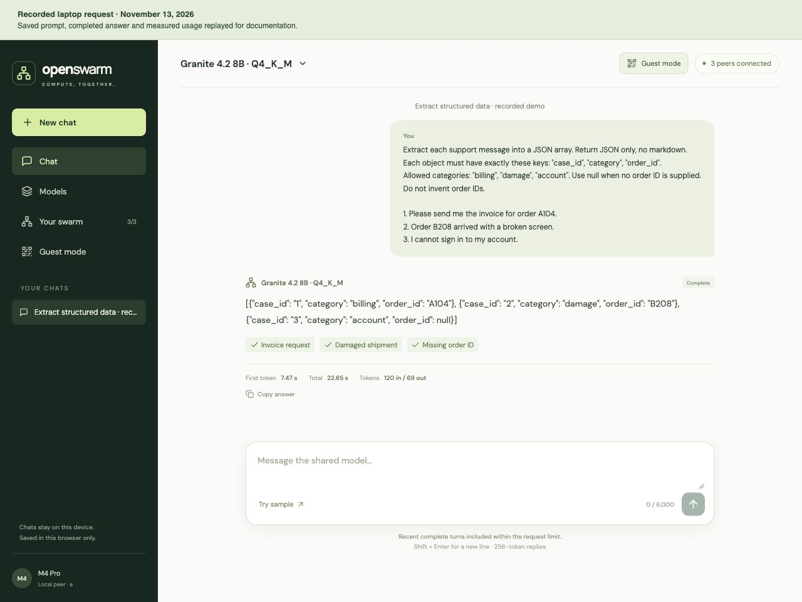
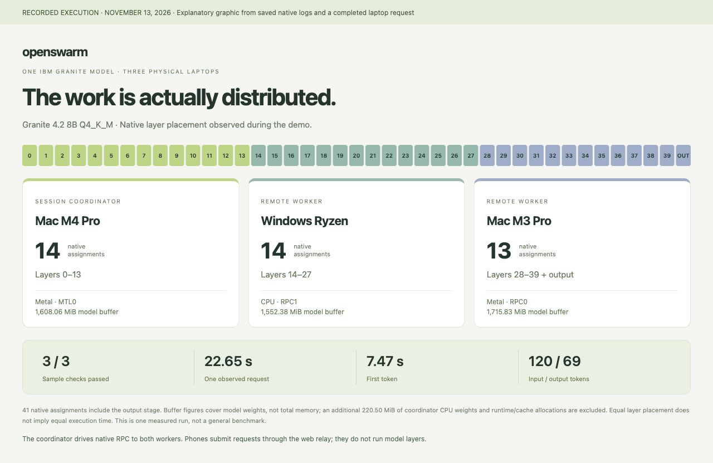
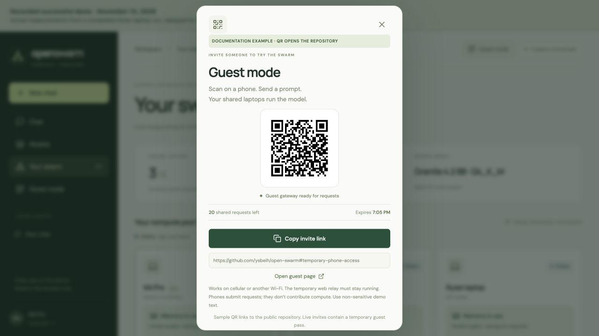

# Open Swarm: share compute, use the model

The core story is contributing laptop capacity and using a model that runs across the participating machines. Guest access is an optional extra at the end.

## 1. Share compute

Original screenshot supplied by the team, preserved unchanged. It shows the three-peer session from the Windows laptop. The 24 GB figure is an offered budget, not measured memory consumption. RSS is incomplete GPU/unified-memory accounting; RPC graph submissions are not tokens or completed kernels.

## 2. Start with a prompt

Original screenshot supplied by the team, preserved unchanged. The loaded shared model is ready for a prompt. This empty view is retained alongside the separate completed-response view below.

## 3. Receive the answer

A recorded physical inference result rendered in the laptop chat interface for documentation. The prompt, answer, checks and usage come from a completed three-laptop run on November 13, 2026. Creating this image did not run another request. All three checks passed: invoice request, damaged shipment and missing order ID.

## 4. Inspect distribution and usage

An explanatory graphic from saved native logs and the same completed request. It is a documentation graphic, not another screen in the application. The model has 40 decoder layers plus an output assignment: M4 handles 0–13, Windows handles 14–27, and M3 handles 28–39 plus output. The coordinator drives RPC to both workers; the ordered layer strip does not depict direct worker-to-worker network traffic.

**Recorded request:** `f31a126338514c49a6fe07d2e9e976c0`. It took 22.651 seconds, with 7.47 seconds to first token, 120 input tokens and 69 output tokens. Buffer sizes cover model weights, not total runtime/cache memory. These observations do not establish general performance, a hard memory cap or 30B feasibility. Raw evidence stays private and ignored by Git.

## 5. Optional extra: invite a phone

The host shares a temporary QR or link so a guest can submit from cellular or another Wi-Fi network. Cloudflare relays the web request; the laptops still execute the model. The phone contributes no model layers and does not join the trusted compute LAN.

This documentation capture uses a **sample QR pointing to the public repository**, not a live guest pass. Readiness, allowance and expiry are recorded example values. The invitation layout is compacted for the capture. No private control credentials or live invitations are included.

The two original captures and the documentation replays show different moments and interface versions. They illustrate the workflow; they are not a claim that the swarm is currently running.
